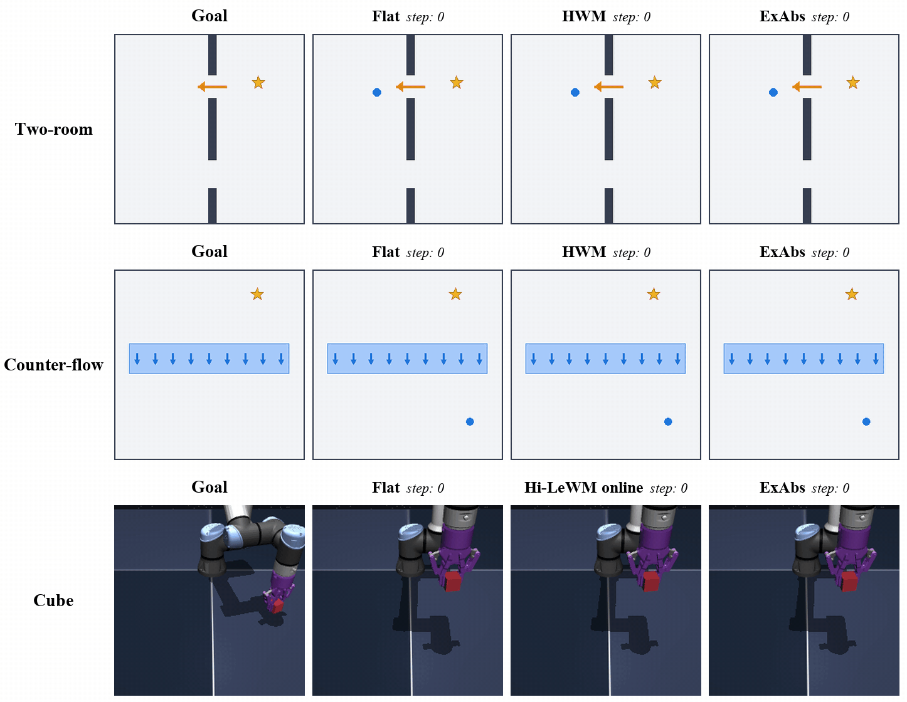
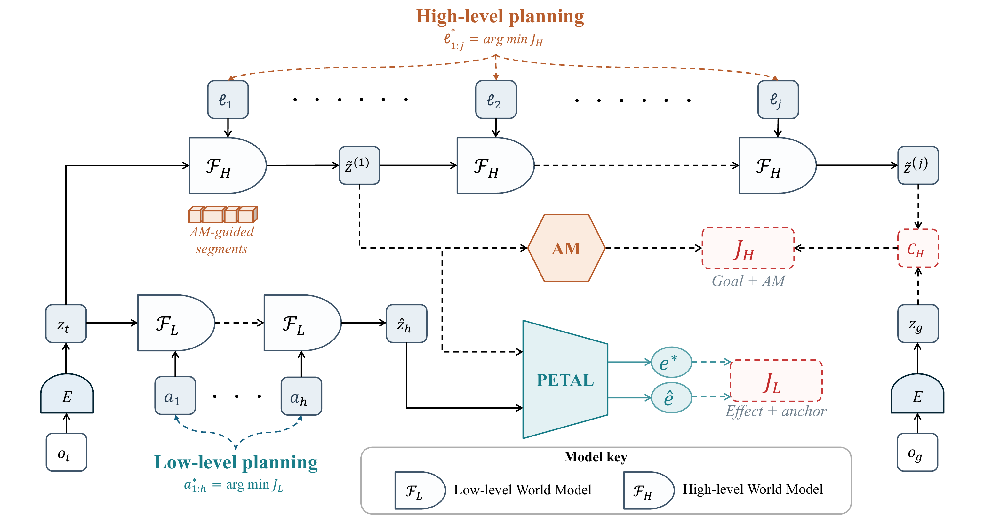

<div align="center">

# ExAbs: Learning Execution-Aware Abstractions for Hierarchical World Models



</div>

# Overview

<p align="center">
  
</p>

Hierarchical world models extend planning horizons by letting a high-level model propose waypoints for a short-horizon controller to reach. ExAbs lets that controller shape the abstractions the hierarchy learns. The encoder $E$ maps the current and goal observations to latents; the high-level world model $\mathcal{F}_H$ searches over macro-actions $\ell$ toward the goal, and the low-level world model $\mathcal{F}_L$ plans primitive actions $a$ toward the first predicted waypoint.

- **Achievability Model (AM)** learns from closed-loop execution the probability that the controller completes a waypoint within a given budget. It selects the segments that train $\mathcal{F}_H$ and scores candidate waypoints in the high-level cost $J_H$, together with the goal term $C_H$.
- **PETAL** distills a frozen low-level planner into compact effect representations. The low-level cost $J_L$ compares the requested effect $e^{\ast}$ with the predicted effect $\hat{e}$ of each candidate and keeps the waypoint as a latent anchor.
- Evaluated on **Two-room**, **Counter-flow**, and **Cube**, against single-level planning and a hierarchical world-model baseline under the same interaction budgets.

# Setup

Tested on Linux with Python 3.10. Model files are stored with [Git LFS](https://git-lfs.com).

```bash
git clone https://github.com/JunhaoChan0803/ExAbs.git
cd ExAbs
git lfs pull

# Two-room and Counter-flow
python -m venv .venv-nav && source .venv-nav/bin/activate
pip install -r requirements.txt
python scripts/check_assets.py
```

Cube uses a separate environment; see the [Cube guide](cube/README.md#setup).

# Run Experiments

```bash
python -m two_room.evaluate --device cuda --method exabs       # or hwm, single
python -m counter_flow.evaluate --device cuda --method exabs   # or hwm, single
python -m cube.evaluate --device cuda --method exabs --distance 50   # or 75
```

Results are written to `outputs/<scene>/`. Each scene guide lists the available methods and options: [Two-room](two_room/README.md), [Counter-flow](counter_flow/README.md), and [Cube](cube/README.md).

# Training

Counter-flow includes the complete training pipeline, which trains PETAL, AM, and the high-level model in turn. Download the training trajectories from the [releases page](https://github.com/JunhaoChan0803/ExAbs/releases), then run from the repository root:

```bash
unzip ExAbs-Training-Data.zip -d ..   # creates ../datasets
python -m counter_flow.train --data-root ../datasets/counter_flow \
  --output outputs/counter_flow/trained --stage all
```

See the [Counter-flow guide](counter_flow/README.md#training) for running individual stages and evaluating the trained model, and the [data guide](datasets/README.md) for the data layout.

<sub>Training pipelines for Two-room and Cube will be released in a future update.</sub>

# Acknowledgements

The navigation world models build on [PLDM](https://github.com/vladisai/PLDM). The Cube experiments build on [LeWorldModel](https://github.com/lucas-maes/le-wm) and its [Cube dataset](https://huggingface.co/datasets/quentinll/lewm-cube), [Hi-LeWM](https://doi.org/10.5281/zenodo.21353240) ([paper](https://arxiv.org/abs/2607.12547)), [OGBench](https://github.com/seohongpark/ogbench), and [StableWorldModel](https://github.com/galilai-group/stable-worldmodel). We thank the authors for releasing their code, models, and data.

# License

The original ExAbs code is released under the [MIT License](LICENSE). Third-party components retain their licenses; see [THIRD_PARTY_NOTICES.md](THIRD_PARTY_NOTICES.md).
